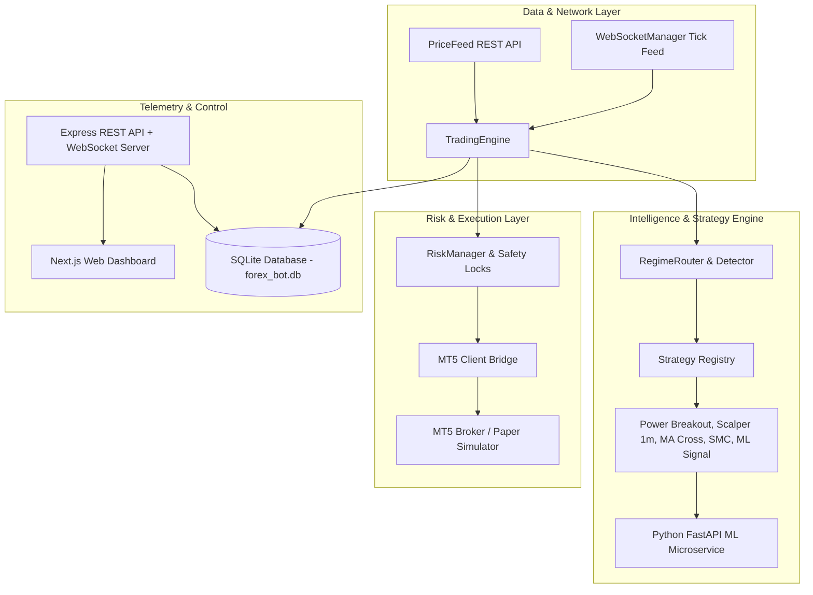

# Treadiiiio Trading Bot — Master System & Operational Guide

Treadiiiio is an institutional-grade, multi-strategy quantitative trading bot written in **TypeScript (Node.js)** and **Python (FastAPI & XGBoost ML)**. It features real-time price processing, cost-aware walk-forward backtesting, dynamic market regime routing, fixed-fractional risk management, broker-level stop enforcement, and a live web dashboard.

---

## 🏛 System Architecture



---

## 🚀 Quick Setup & Configuration

### Prerequisites
- **Node.js**: v20+
- **Python**: v3.11+
- **MetaTrader 5 (Optional)**: For live broker execution (Bridge API on port 8000)

### Step 1: Clone & Install Dependencies
```bash
# Install Node.js backend dependencies
npm install

# Install Next.js dashboard dependencies
cd dashboard && npm install && cd ..
```

### Step 2: Configure Environment Variables
Copy `.env.example` to `.env` in root:
```bash
cp .env.example .env
```

Key Safety & Execution Parameters:
```env
# SAFETY MODE — PAPER TRADING (Always true by default)
USE_SIMULATOR=true

# API & Security Settings
PORT=4000
API_SECRET_KEY=YourSuperSecretKey32CharsLong!

# Risk & Friction Model
STARTING_BALANCE=10000
SPREAD_PIPS=1.5
SLIPPAGE_PIPS=0.5
RISK_DAILY_LOSS_LIMIT_PCT=5.0
RISK_MAX_CONCURRENT_POSITIONS=5

# Strategy Controls
ENABLED_STRATEGIES=power_breakout,scalping_1m,ma_crossover,rsi_reversion,ml_signal
POWER_ADX_MIN=20.0
POWER_ATR_EXPANSION_RATIO=1.05
```

---

## 🧪 Walk-Forward Backtester

Run the cost-aware walk-forward backtesting suite across multi-regime historical data:
```bash
npx ts-node src/analytics/runWalkForward.ts
```

Output includes out-of-sample win rates, profit factor, expectancy per trade ($ and pips), Sharpe ratio, and Walk-Forward Efficiency (WFE) index.

---

## 🛡 Risk Management & Safety Features

1. **Fixed-Fractional Position Sizing**: Calculated dynamically from current account equity and stop loss distance:
   $$\text{Units} = \frac{\text{Equity} \times \text{Risk \%}}{\text{SL Pips} \times \text{Pip Value}}$$
2. **Hard Daily Circuit Breaker**: Auto-pauses trading when cumulative daily drawdown reaches 5% of starting equity.
3. **Broker-Level Hard Stop Loss**: Every placed order guarantees an associated `sl_pips` ticket directly at the broker level.
4. **Emergency Kill Switch**: Accessible via HTTP `POST /api/bot/kill` or dashboard button to pause trading and immediately liquidate all open positions.

---

## 📊 Running the Bot & Dashboard

### Start Backend Engine & API Server
```bash
# Development Mode (auto-reload)
npm run dev

# Production Build
npm run build
npm start
```

### Start Live Dashboard
```bash
cd dashboard
npm run dev
```
Open [http://localhost:3000](http://localhost:3000) to view real-time portfolio metrics, equity curves, active positions, and controls.

---

## 📋 Next Improvements (Ranked by Expected Edge & Impact)

1. **High-Frequency Tick Storage & Order-Book L2 Microstructure Integration**: Store raw tick-by-tick level 2 order-book data for ultra-fast scalping entry confirmation.
2. **Machine Learning Model Ensemble (XGBoost + LightGBM + LSTM)**: Upgrade ML microservice to ensemble predictions from XGBoost and neural network models.
3. **Automated Dynamic Parameter Optimization (Optuna/Bayesian)**: Implement periodic automated hyperparameter optimization for Donchian and ATR thresholds across rolling 30-day windows.
